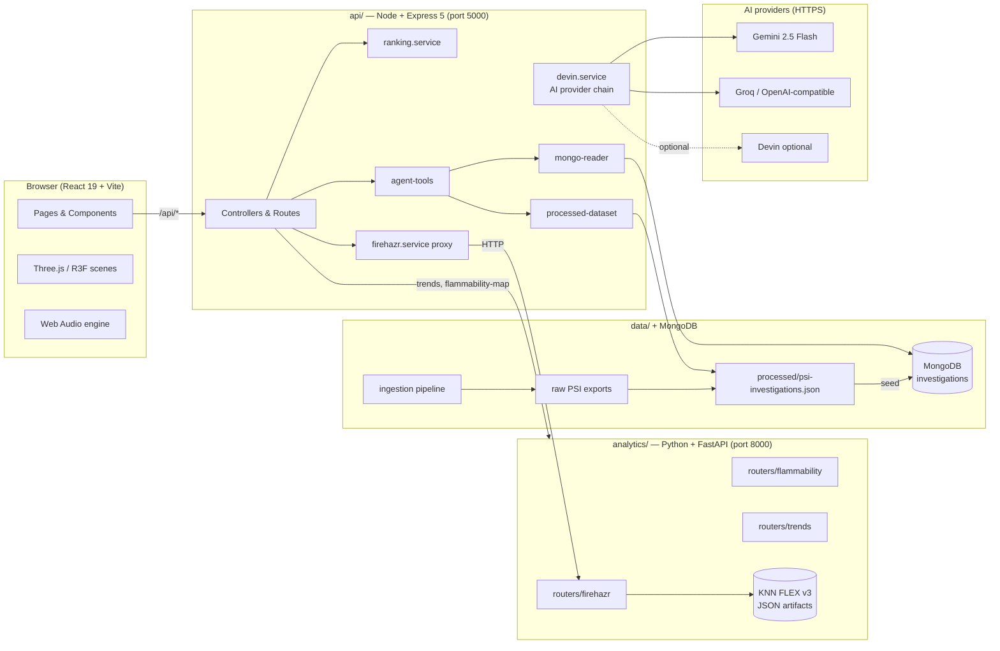
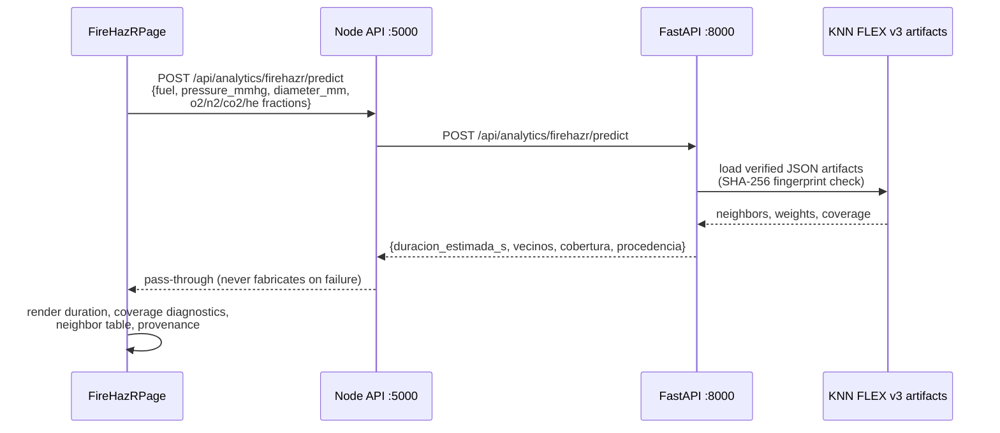
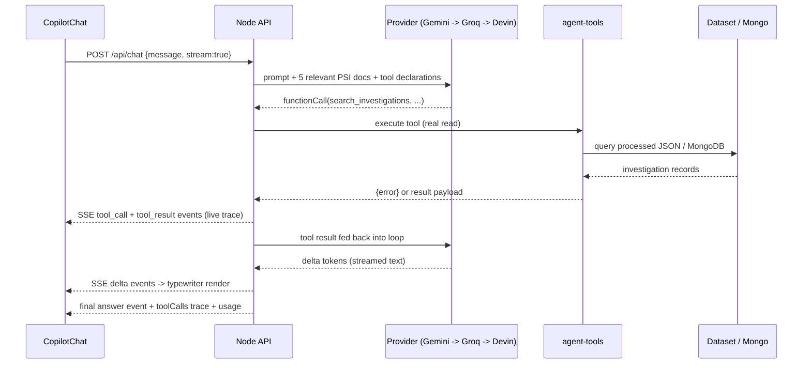

# 02 — System Architecture

## Overview

Heimdall is a three-service application plus a shared data folder and a 3D
asset pipeline. Each service is independently deployable and degrades honestly
when a dependency is unavailable.



## Service responsibilities

| Service | Dir | Stack | Responsibility |
|---|---|---|---|
| Frontend | `frontend/` | React 19, Vite 8, Three.js/R3F, Recharts | All UI: Mission Hub, PSI Catalog, Parametric Comparison, FireHazR lab, copilot |
| API | `api/` | Node >= 20, Express 5, Mongoose | REST endpoints, PSI dataset access (Mongo + processed JSON), ranking, AI provider chain, agent tools, analytics proxy |
| Analytics | `analytics/` | Python, FastAPI, Uvicorn | FireHazR KNN FLEX v3 inference, flammability-map grid, trend detection |
| Data | `data/` | Node scripts | `raw/` -> `ingestion/` -> `processed/` -> `npm run seed` |
| Assets | `assets3d/` | Blender | `.blend` sources exported to `.gltf`/`.glb`, copied to `frontend/public/models/` |

## Key request flows

### FireHazR prediction (synchronous)



If FastAPI is down the Node proxy returns an honest 503; the UI shows
"FireHazR analytics is unavailable" rather than an invented duration.

### Copilot agent turn (SSE streaming)



Tool failures are returned to the model as `{error}` so it reports the
limitation verbatim — the UI renders the real trace, never simulated steps.

### Provider failover chain

```mermaid
flowchart TD
    REQ[chat() or interpretFirehazrResult] --> ORDER{AI_PROVIDER}
    ORDER -->|auto| P1[Gemini]
    ORDER -->|forced| PX[selected provider only]
    P1 -->|ok| OUT[streamed response]
    P1 -->|429 / 5xx / network<br/>before any output| P2[OpenAI-compatible Groq]
    P2 -->|ok| OUT
    P2 -->|fails before output| P3[Devin if configured]
    P3 -->|ok| OUT
    P1 & P2 & P3 -->|fail after partial output| NO[No failover —<br/>never duplicate a response]
    P3 -->|all exhausted| ERR[honest error to client]
```

Each provider has an independent token budget (60,000 tokens) so one
provider's exhaustion does not block fallback.

## Data sources at runtime

The API resolves investigation records from two sources:

1. **MongoDB** (`mongo-reader.service.js`) — read-only; no inserts, updates,
   deletes, `$out`, or `$merge` from the AI path.
2. **Processed JSON fallback** (`utils/processed-dataset.js`) — loads
   `data/processed/psi-investigations.json` (also checked at
   `api/data/processed/` for the Azure package layout). Missing or corrupt
   files degrade to an empty list with a logged warning — never a crash.

The frontend `api.js` adds a third tier: if the API is unreachable it falls
back to the bundled processed dataset so the catalog still renders offline.

## Boundaries and trust rules

- The frontend never holds secrets. `VITE_*` variables carry only the proxy
  target; provider keys live exclusively in `api/.env` (gitignored).
- The analytics service owns all model inference; Node is a pass-through.
- The AI layer may read data through tools but may not write anywhere.
- The 3D layer is presentational: planet selection cannot inject values into
  scientific inputs.
