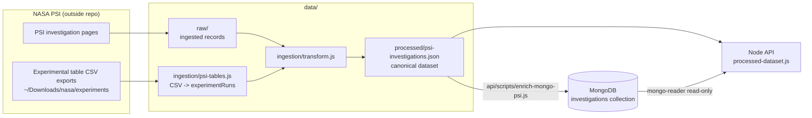

# 03 — Data Pipeline

## Overview

NASA PSI data flows through a three-stage pipeline into two queryable forms:
a canonical processed JSON file and a MongoDB collection.

## Stages

### 1. Raw ingestion

- `data/raw/` holds the ingested PSI investigation records produced by
  `data/ingestion/pipeline.js`.
- The NASA PSI "Experimental table" CSV exports stay **outside** the repo
  (`data/raw/psi-tables/` is gitignored; currently in
  `~/Downloads/nasa/experiments`). `ingestion/psi-tables.js` merges per-run
  measurements into each investigation.

### 2. Per-run measurement merge (`psi-tables.js`)

When CSVs are present, each experimental run contributes:

- `experimentRuns` — individual run records.
- Measured `conditions` ranges — **O2 min/max, pressure median, flow median** —
  computed only from values that parse to real numbers. They are physically
  bounded and never extrapolated.
- `series` curves with per-series PSI provenance (`seriesSource`).
- Unparseable values (`"LOW O2"`, `"Insignificant"`, `"3400%"`) are dropped,
  never guessed.
- PSI-142 (bibliographic summary) and PSI-181 (Pb-Sn microscopy, not fire
  safety) are intentionally skipped.
- Missing CSVs are skipped gracefully — the pipeline does not fail.

### 3. Canonical processed dataset

`data/processed/psi-investigations.json` is the single source of truth loaded
at runtime by `api/src/utils/processed-dataset.js`:

- Candidate paths: `data/processed/`, then `api/data/processed/` (Azure
  package layout), then `process.cwd()/data/processed`.
- Missing or invalid JSON -> cached `[]` + warning; the server stays up.

### 4. MongoDB enrichment

`api/scripts/enrich-mongo-psi.js` mirrors canonical processed records into the
MongoDB `investigations` collection while respecting its `$jsonSchema`
validator:

- Mongo `status` stays `ingested` / `catalog_only`.
- Canonical status travels in `psiStatus`; `processed-dataset.js` resolves
  effective status as `doc.psiStatus ?? doc.status ?? ...`.
- Result: MongoDB is the complete live data source; the JSON file is the
  offline/packaged fallback.

## Investigation record shape (consumed fields)

| Field | Meaning |
|---|---|
| `psiId`, `acronym`, `title` | Identity (e.g. `FLEX`, `PSI-###`) |
| `category` | Pillar: `prevention` / `detection` / `suppression` |
| `hardware` | Facility string; `getHardwareFamily()` maps to CIR/MDCA, MSG, etc. |
| `fuel` | Fuel and sample description |
| `status` / `psiStatus` | `published`, `upcoming`, `ingested`, `catalog_only` |
| `dataAvailable` | `false` for placeholder studies (LUCI, FM2) with no PSI data yet |
| `gravityLevel` | `microgravity`, `1g`, or proxy tags like `partial-gravity-proxy` |
| `conditions` | `{ oxygenPct, oxygenMinPct, oxygenMaxPct, pressurePsi, flowVelocity }` |
| `variables`, `sensors`, `objective` | Experimental description fields |
| `series`, `seriesSource` | Measured curves + PSI provenance |
| `experimentRuns` | Per-run measured rows (when CSVs were ingested) |
| `aiSummary` | `{ student, engineer }` audience-aware summaries |
| `tags` | Classification tags used by matrix/filters |

## Provenance rules

1. Every measured number must trace to a PSI record or a model artifact —
   never interpolated into "plausible" values.
2. `dataAvailable: false` renders as an explicit "No PSI data yet" state.
3. `series` carries `seriesSource`; when a study has no measured samples the
   UI says "Metadata / summary only".
4. CSV-derived ranges keep physical bounds; medians only — no extrapolation.
