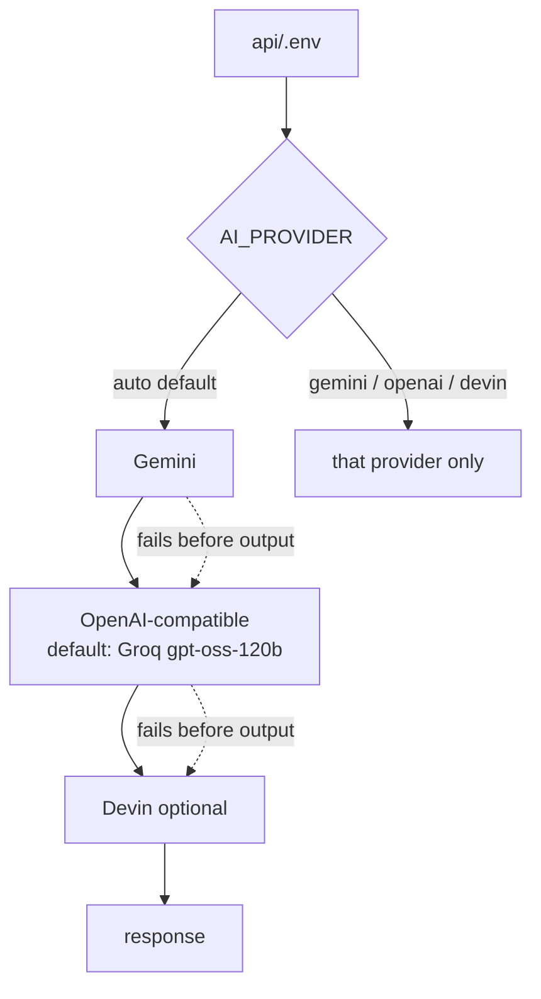
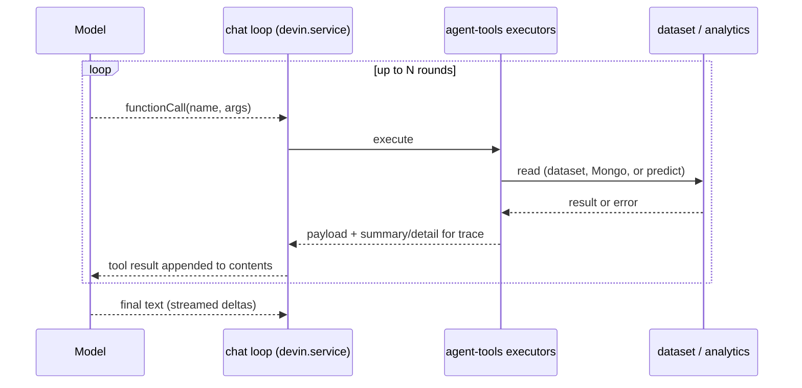

# 07 — AI Copilot and Provider Chain

All AI calls go through `api/src/services/devin.service.js`. The module name
is historical — it hosts a multi-provider agentic engine, not a single Devin
integration.

## Provider resolution

`resolveAiProviders()` builds the ordered chain from env config:

- `hasAiProviderConfigured()` is true if any provider has a key.
- `activeAiProvider()` reports the first configured provider;
  `GET /api/chat/status` exposes `provider`, `providerLabel`,
  `fallbackProviders`, and `budget`.
- Providers are skipped if their key/base is unset — an empty `DEVIN_API_KEY`
  simply drops Devin from the chain.

## Failover semantics

- A provider failure (429, 5xx, network) triggers the next provider **only
  before any output has been streamed**.
- If a provider streams partial output then dies, there is **no failover** —
  duplicating a response would corrupt the transcript; the error is surfaced
  instead.
- Each provider has its own token budget so one provider's exhaustion does
  not consume the fallback's allowance.

## Agentic tool loop

`AGENT_TOOL_DECLARATIONS` (`agent-tools.js`) declares five tools; both
provider paths run the same loop.

| Tool | What it does (real reads only) |
|---|---|
| `search_investigations` | Query the processed dataset / Mongo by text, pillar, fuel, hardware |
| `get_investigation` | Full detail for one study |
| `rank_investigations` | Run the transparent ranking engine with a scenario + weights |
| `predict_burn_duration` | Call FireHazR through the analytics proxy |
| `list_mission_scenarios` | Enumerate the five mission environments |

- **Gemini** uses native function declarations.
- **OpenAI-compatible** providers get the same tools converted to
  `{type:'function', function:{...}}` `chat/completions` format.
- Both paths support multiple tool rounds, `tool_call`/`tool_result` trace
  events, and streamed text deltas.
- Tool executors return `{error}` on failure so the model states the
  limitation verbatim — the trace the UI shows is real execution, not a
  scripted animation.

## SSE streaming (`POST /api/chat`, `stream:true`)

| Event | Payload |
|---|---|
| `tool_call` | label + formatted args (`formatToolArgs`) |
| `tool_result` | summary + detail (`summarizeToolResult` / `detailToolResult`) |
| `delta` | text token chunk (Gemini `streamGenerateContent`; normalize `\r\n` before splitting SSE blocks — Gemini uses CRLF) |
| `answer` | final message, `toolCalls` trace, `usage`, `providerLabel` |

OpenAI-compatible SSE is parsed the same way, accumulating streamed tool-call
fragments before executing them.

## Token budgets and prompt economy

| Control | Env | Default | Purpose |
|---|---|---|---|
| Global provider budget | `*_TOKEN_LIMIT` | 60,000 (was 120,000) | hard stop per provider |
| General output cap | `*_MAX_OUTPUT_TOKENS` | 512 | keep answers tight |
| Interpretation cap | `AI_INTERPRET_MAX_TOKENS` | 320 | dedicated FireHazR brief budget |

Prompt-size controls that keep requests under free-tier TPM limits:

- Copilot context is trimmed to the **5 most relevant PSI docs**; tools fetch
  anything else on demand.
- `compactFirehazrResult()` sends only the **top-3 neighbors** into
  interpretation prompts.
- Reasoning models: Gemini interpretation sets `thinkingBudget: 0`;
  OpenAI-compatible requests use `reasoning_effort: low`
  (`OPENAI_COMPAT_REASONING_EFFORT`) — otherwise hidden reasoning consumes
  the output budget and returns empty/truncated text.

## FireHazR interpretation (`POST /api/analytics/firehazr/interpret`)

- **Not** SSE — a normal JSON request.
- The deterministic readout (frontend `buildFireHazrDeterministicSummary`)
  always renders for valid model output and is labeled separately.
- The AI brief only appears on a real provider response and is labeled with
  the provider's name.
- No provider configured -> **503** `{error:{message}}`; coverage abstention
  -> 200 `skipped` (a legitimate null interpretation).
- Prompts enforce: never invent numbers — describe only the returned
  duration, neighbors, and coverage.

## Mongo access rule

All AI-path database access goes through `mongo-reader.service.js` and is
strictly **read-only**: no inserts, updates, deletes, `$out`, or `$merge`.

## Honesty guarantees

- `GET /api/chat/status` reports the real active provider and fallbacks; the
  UI labels itself dynamically (never hardcodes "Gemini").
- Quota exhaustion is shown as the provider's actual error (e.g. Gemini 429),
  not a canned message.
- A missing dataset/tool is reported to the model as `{error}` — it must say
  "I could not retrieve that" rather than fabricate.
